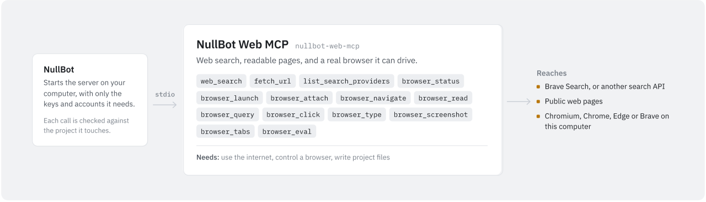

# NullBot Web MCP

<picture>
  <source media="(prefers-color-scheme: dark)" srcset="assets/nullbot-web-mcp-dark.svg">
  
</picture>

`nullbot-web-mcp` lets an agent search the web, fetch public pages as readable text, and drive a local Chromium-family browser (Chrome, Edge, Brave, or Chromium) through the Chrome DevTools Protocol (CDP) on localhost. It is a standalone Go MCP server built on [`github.com/Bradthebrad/tinychain/mcp`](https://github.com/Bradthebrad/tinychain). It works with NullBot and with any MCP client, and uses stdio by default.

## Tools

| Tool | What it does |
| --- | --- |
| `web_workspace_info` | Shows the workspace and path rules, the search provider and which keys are present, the browser and CDP settings, whether `browser_eval` is on, the fetch cap, and the tool list. |
| `list_search_providers` | Lists the search providers, which one is selected, and whether each has a key. Never returns key values. |
| `web_search` | Searches the web with the selected provider. Only Brave Search works in this build. `limit` defaults to 10 (at most 20); `provider` overrides the provider for one call. |
| `fetch_url` | Fetches a public `http` or `https` URL and returns readable text, the body as text, or only headers. Local and private addresses are blocked. |
| `browser_status` | Checks whether the CDP endpoint answers and reports attach state, tabs, the active tab, and what to do next. Works without a running browser. |
| `browser_attach` | Connects to a browser that is already running with remote debugging on localhost. |
| `browser_launch` | Starts Chrome, Edge, Brave, or Chromium with remote debugging on `127.0.0.1`, using a new temporary profile unless you pass `profile_dir`. |
| `browser_navigate` | Opens an `http` or `https` URL in the active tab and waits for the page body. |
| `browser_read` | Reads the active tab, or one CSS selector, as `text` (default), `readability` text, a DOM `outline`, or `html`. `output_limit` defaults to 32768 bytes (at most 131072). |
| `browser_screenshot` | Saves a PNG of the viewport, or the full page with `full_page: true`, to a workspace-relative `.png` path. |
| `browser_query` | Finds elements by CSS selector and returns their text, common attributes, visibility, and bounding box. `limit` defaults to 20 (at most 100). |
| `browser_click` | Clicks the single element that matches a CSS selector, or the point given by `x` and `y`. Fails if the selector matches more than one element. |
| `browser_type` | Types text into the single element that matches a selector, or into the focused element. `clear` empties the field first; `submit` presses Enter after typing. |
| `browser_tabs` | Lists, selects, opens, or closes tabs. Will not close the last page unless `force` is true. |
| `browser_eval` | Runs a JavaScript expression of up to 8192 bytes in the active tab. Off unless the server starts with `--allow-eval=true`. |

Browser tools take a `timeout` in seconds: 15 by default, at most 60.

A typical search flow:

1. `list_search_providers` to confirm a provider is ready.
2. `web_search` with a focused query and a small `limit`.
3. `fetch_url` on the promising results to read the pages themselves.
4. Cite the fetched pages rather than the search snippets.

A typical browser flow:

1. `browser_status`.
2. `browser_launch`, or start a browser yourself and call `browser_attach`.
3. `browser_navigate` to the page.
4. `browser_read` with `mode: "readability"`, and `browser_query`, `browser_click`, or `browser_type` as needed.
5. `browser_screenshot` to a path such as `screenshots/page.png` if you need a picture of the page.

## Use it with NullBot

NullBot is a small, auditable Go agent ([Bradthebrad/nullbot](https://github.com/Bradthebrad/nullbot)) with a terminal UI and a headless CLI. Its main interface is the desktop app ([Bradthebrad/nullbot_ui](https://github.com/Bradthebrad/nullbot_ui)).

1. In the desktop app, open **Tools > Marketplace** and choose **Install** on NullBot Web MCP. **Check for updates** refreshes the catalog from GitHub releases. The Marketplace installs the latest release, currently `v0.1.0`.
2. NullBot installs the server to `~/.nullbot/mcp/nullbot-web-mcp` and, when the release has a `SHA256SUMS.txt`, verifies the binary against it.
3. NullBot starts the server over stdio with `--workspace` set to the folder of your primary project.
4. To use `web_search`, add your Brave Search API key in **Settings > Accounts**. NullBot passes it to the server as `BRAVE_API_KEY`.

NullBot checks every tool call against the permission of the project it touches: Read only, Read & write, Full, or Custom. Full is needed to run programs. Where projects overlap, the stricter one wins. A call that names no folder is judged by the primary project.

NullBot works out what each tool needs (read, write, delete, or run) from the server's hints and the tool's name. You can change it per tool on the Tools page. This server sends no hints, so the names decide. With NullBot's current rules:

- `browser_attach`, `browser_launch`, and `browser_eval` need run, so they only work in a Full project.
- `browser_click` and `browser_type` need write.
- `browser_screenshot` needs write access to the folder in `output_path`.
- All other tools need read, including `browser_navigate` and `browser_tabs`, even though `browser_tabs` can open and close tabs.

Related skill packages in [Bradthebrad/nullbot-skills](https://github.com/Bradthebrad/nullbot-skills), also offered in the Marketplace:

- [web-search](https://github.com/Bradthebrad/nullbot-skills/tree/main/skills/web-search): search, sort through results, fetch public pages safely, and pull readable text.
- [web-tools](https://github.com/Bradthebrad/nullbot-skills/tree/main/skills/web-tools): when to search and when to drive a browser, and the safety rules for this server.
- [browser-automation](https://github.com/Bradthebrad/nullbot-skills/tree/main/skills/browser-automation): launch or attach, navigate, read, click, type, screenshots, and tabs.
- [browser-research](https://github.com/Bradthebrad/nullbot-skills/tree/main/skills/browser-research): multi-step research that combines search, fetches, rendered pages, screenshots, and citations.
- [mcp-skill](https://github.com/Bradthebrad/nullbot-skills/tree/main/skills/mcp-skill): for building a server like this one.

## Use it with another MCP client

Point the client at the binary and pass `--workspace`. The config format varies by client; a common shape is:

```json
{
  "mcpServers": {
    "web": {
      "command": "C:\\path\\to\\nullbot-web-mcp.exe",
      "args": ["--workspace", "C:\\path\\to\\workspace"],
      "env": {
        "BRAVE_API_KEY": "YOUR_BRAVE_API_KEY"
      }
    }
  }
}
```

The workspace is only used for screenshots. Without `--workspace`, the server uses the folder it was started in.

## Configuration

### Flags

| Flag | Default | Meaning |
| --- | --- | --- |
| `--transport` | `stdio` | `stdio`, `streamable-http`, `http`, or `sse`. |
| `--addr` | `127.0.0.1:8780` | Listen address for the HTTP and SSE transports. Keep it on loopback. |
| `--path` | `/mcp` | Streamable HTTP endpoint. |
| `--sse-path` | `/sse` | Legacy SSE endpoint. |
| `--message-path` | `/message` | Legacy SSE message endpoint. |
| `--workspace` | `.` | Folder that screenshot paths are relative to. |
| `--search-provider` | `auto` | `auto`, `brave`, `tavily`, `serpapi`, `bing`, or `none`. |
| `--cdp-endpoint` | `http://127.0.0.1:9222` | Localhost CDP endpoint for `browser_status` and `browser_attach`. |
| `--browser-path` | empty | Chrome, Edge, or Brave executable for `browser_launch`. |
| `--allow-eval` | `false` | Turns on `browser_eval` only when set to `true`. |
| `--brave-api-key` | empty | Brave Search key. When empty, `BRAVE_API_KEY` is used. |
| `--tavily-api-key` | empty | When empty, `TAVILY_API_KEY` is used. The Tavily provider is not implemented. |
| `--serpapi-api-key` | empty | When empty, `SERPAPI_API_KEY` is used. The SerpAPI provider is not implemented. |
| `--bing-api-key` | empty | When empty, `BING_API_KEY` is used. The Bing provider is not implemented. |
| `--max-fetch-bytes` | `524288` | Most bytes `fetch_url` reads from a response. |
| `--version` | `false` | Print the version and exit. |

### Environment variables

| Variable | Used for |
| --- | --- |
| `BRAVE_API_KEY` | Brave Search, used by `web_search`. |
| `TAVILY_API_KEY`, `SERPAPI_API_KEY`, `BING_API_KEY` | Recognized and reported, but these providers are not implemented. |

A key given as a flag takes priority over the environment variable.

### Search providers

Brave Search is the only working provider in this build. Tavily, SerpAPI, and Bing are listed and report "not implemented".

With `--search-provider auto`, the server picks the first provider that has a key, in the order Brave, Tavily, SerpAPI, Bing. If only a Tavily, SerpAPI, or Bing key is set, `auto` picks that provider and `web_search` returns a "not implemented" error. Key values are never returned by `web_workspace_info` or `list_search_providers`; only whether a key is present.

Example `web_search` arguments:

```json
{
  "query": "NullBot MCP server examples",
  "limit": 5,
  "provider": "auto"
}
```

### URL fetching

`fetch_url` arguments:

- `url`: a public `http` or `https` URL.
- `output_mode`: `readability` (default) extracts readable text from HTML, `text` and `raw` both return the body as text, `headers` and `none` return only status and headers.
- `output_limit`: most bytes of text to return. Defaults to 65536, at most 131072.

Each fetch times out after 20 seconds and follows at most 5 redirects. The returned headers are limited to `Content-Type`, `Content-Length`, `Last-Modified`, `ETag`, `Location`, and `Cache-Control`.

```json
{
  "url": "https://example.com/",
  "output_mode": "readability",
  "output_limit": 12000
}
```

### Browser control

The server controls the browser over CDP and only accepts loopback endpoints (`localhost`, `127.0.0.1`, or `[::1]`), for example:

- `http://127.0.0.1:9222`
- `http://localhost:9222`
- `ws://127.0.0.1:9222/devtools/browser/<id>`

Option A: start a browser yourself, then call `browser_status` and `browser_attach`. Chrome example:

```powershell
& "C:\Program Files\Google\Chrome\Application\chrome.exe" `
  --remote-debugging-address=127.0.0.1 `
  --remote-debugging-port=9222 `
  --user-data-dir="$env:TEMP\nullbot-chrome-profile"
```

Edge and Brave take the same flags with their own executable.

Option B: call `browser_launch`. It starts the browser with `--remote-debugging-address=127.0.0.1`, `--no-first-run`, and `--no-default-browser-check`, waits up to 5 seconds for the endpoint, and then you call `browser_attach`.

- The port comes from `port`, else from `--cdp-endpoint`, else 9222.
- The browser comes from `browser_path`, else `--browser-path`, else a search: on Windows, `chrome.exe`, `msedge.exe`, and `brave.exe` on the `PATH` and in the usual install folders under Program Files and LocalAppData; elsewhere, `google-chrome`, `chromium`, `chromium-browser`, `microsoft-edge`, `brave-browser`, and `brave` on the `PATH`.
- Leave out `profile_dir` (or set `temporary_profile: true`) to get a new temporary profile, which is deleted when the browser exits. Pass `profile_dir` only when you want a profile that keeps cookies, sessions, and history between runs.
- One server process runs at most one launched browser at a time.

### Troubleshooting

- `browser_status` says the endpoint is unreachable: start the browser with `--remote-debugging-address=127.0.0.1 --remote-debugging-port=9222` and check that the port matches `--cdp-endpoint`.
- `browser_attach` reports no websocket URL: the endpoint may not be a Chromium DevTools endpoint. Open `http://127.0.0.1:9222/json/version` locally and check that it returns `webSocketDebuggerUrl`.
- Search provider unavailable: run `list_search_providers`. For Brave, set `BRAVE_API_KEY` or pass `--brave-api-key`.
- Screenshot path rejected: use a relative `.png` path inside the workspace, such as `screenshots/home.png`.
- `browser_eval_disabled`: restart the server with `--allow-eval=true`, only if JavaScript evaluation is needed and approved.

See [docs/SMOKE_TESTS.md](docs/SMOKE_TESTS.md) for manual smoke tests.

## Safety

[SECURITY.md](SECURITY.md) has the full notes. In short:

Network (`web_search`, `fetch_url`, `browser_navigate`):

- These tools contact outside sites. `web_search` sends your query to the search provider. Do not put secrets in queries or URLs.
- `fetch_url` rejects non-`http(s)` URLs, URLs with embedded credentials, `localhost` and `*.localhost`, and any address that is loopback, private, link-local, multicast, unspecified, or otherwise not public. Every address a host name resolves to is checked when connecting, and each redirect is checked again.
- `fetch_url` ignores proxy settings, so a proxy cannot route around these checks.
- `browser_navigate` and `browser_tabs` with `action: "open"` only require an `http` or `https` URL with a host and no embedded credentials. They do not block local or private addresses, so the browser can open pages on localhost and your local network.

Browser control (all `browser_*` tools):

- Browser tools read and operate a real browser. If the browser uses a profile that is signed in to services, the tools can act in those sessions.
- Confirm with the user before purchases, sends or submissions, deletes, account or permission changes, entering or submitting private data, financial, medical, legal, employment, or identity-related tasks, and any other action with outside effects.
- Read-only tools (`browser_status`, `browser_read`, `browser_query`, `browser_screenshot`) can still expose sensitive page content when the browser is signed in. Treat captured text and screenshots as sensitive.
- CDP endpoints must be on loopback. Never bind remote debugging to `0.0.0.0`, a LAN address, or a public interface.
- `browser_launch` uses a temporary profile by default. `profile_dir` takes any folder path, is not limited to the workspace, and is kept after the browser closes. Do not point it at your everyday browser profile.
- `browser_eval` is off by default. JavaScript can read or change page state, send requests, and submit forms. Even with `--allow-eval=true`, keep expressions short and specific, and do not use it for consequential actions without confirmation.

Workspace writes (`browser_screenshot`):

- `output_path` must be a relative path inside the workspace ending in `.png`. Empty paths, absolute paths, `..` escapes, and parent folders that are symlinks to outside the workspace are rejected. Missing parent folders are created.

Keys and transports:

- Tools report only whether a key is present, never its value. Keep real keys out of shared scripts, logs, screenshots, and documents.
- The HTTP and SSE transports have no authentication. Keep `--addr` on `127.0.0.1`.

## Build and test

The module needs Go 1.26.4 (from `go.mod`) and depends on `github.com/Bradthebrad/tinychain` v0.2.0 and `github.com/chromedp/chromedp`.

```powershell
gofmt -w .
go test ./...
go vet ./...
go build -trimpath -ldflags "-s -w" -o .\bin\nullbot-web-mcp.exe .\cmd\nullbot-web-mcp
```

On Linux or macOS, drop the `.exe` from the output name. `nullbot-web-mcp --version` prints the version.

On 2026-10-27, `go vet ./...` and `go test ./...` passed with Go 1.26.4 on Linux.

### Release packaging

`scripts/release.ps1` builds Windows release files:

```powershell
.\scripts\release.ps1 -Version v0.1.0 -NoCompress
```

It runs `go test ./...`, builds with `-trimpath -ldflags "-s -w"`, and writes these files to `dist\releases\<version>`:

- `nullbot-web-mcp.exe`: the normal Windows build.
- `nullbot-web-mcp-small.exe`: a UPX-compressed copy, made only without `-NoCompress`. Pass `-UpxPath` if UPX is not at the script's default path. Compressed binaries can trigger antivirus or SmartScreen warnings; use the normal build if Windows blocks it.
- `SHA256SUMS.txt`: SHA256 checksums of the executables.
- `RELEASE_NOTES.md`: release notes.

Without `-Publish`, the script only writes local files. With `-Publish`, it uses the GitHub CLI (`gh`, or `-GhPath`) to create a GitHub release for `-Version` in `-Repo` (default `Bradthebrad/nullbot-web-mcp`) and uploads the executables and `SHA256SUMS.txt`. If that release already exists, it stops unless `-UpdateExisting` is also passed, which replaces the assets.

## Limitations

- Brave Search is the only working search provider in this build, and Brave requests use `search_lang=en`.
- Browser automation needs a local Chromium-family browser with CDP. Other browsers cannot be controlled.
- `fetch_url` blocks localhost and private network addresses on purpose, so it cannot fetch from internal networks.
- Readability extraction is simple and may miss parts of some page layouts.
- `browser_eval` is off by default.
